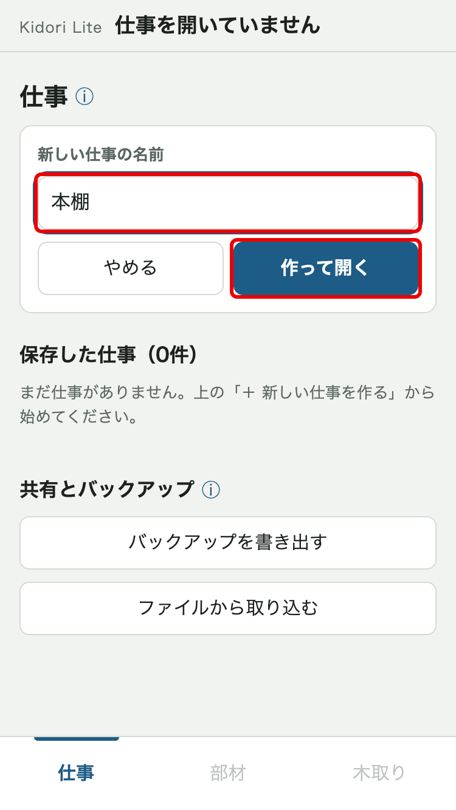
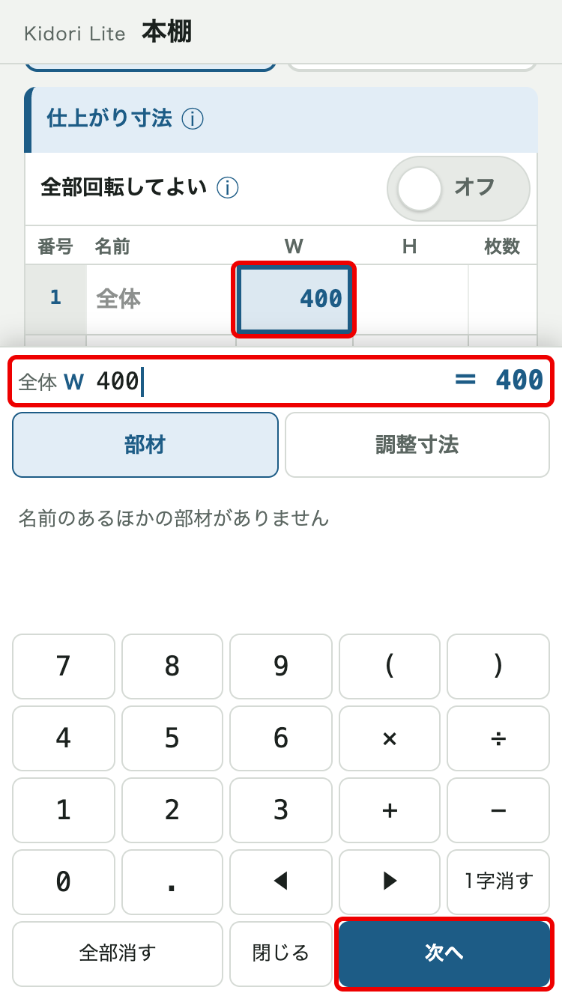
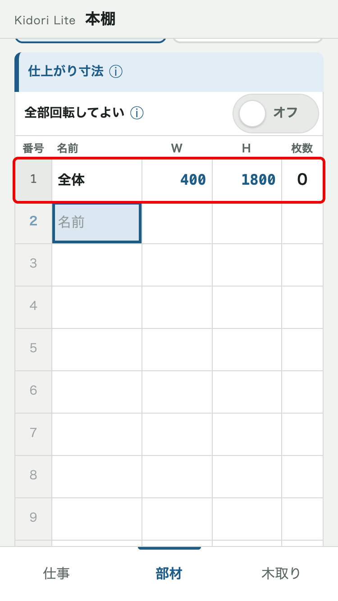
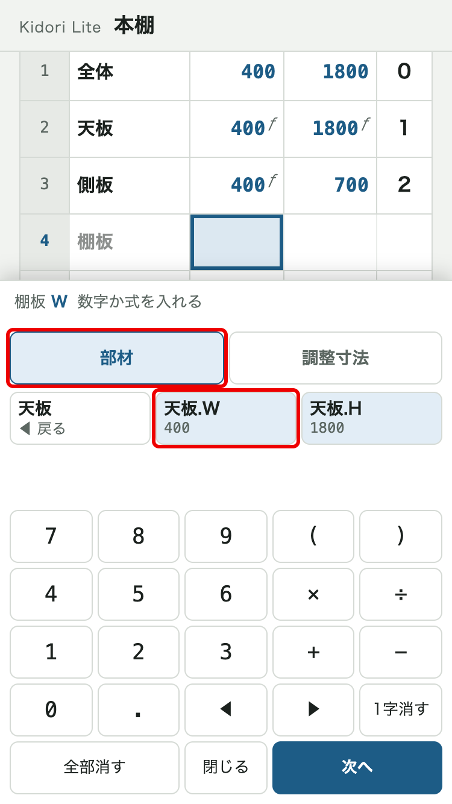
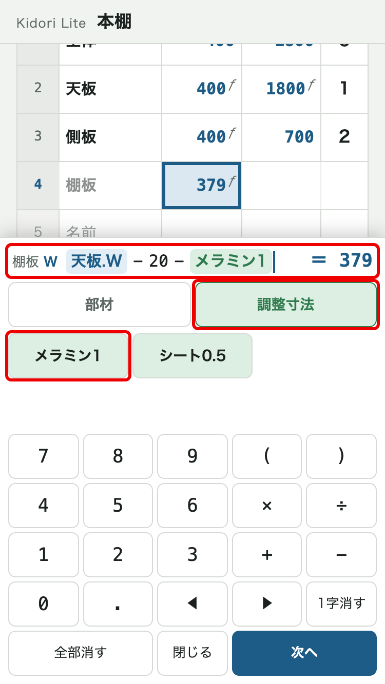
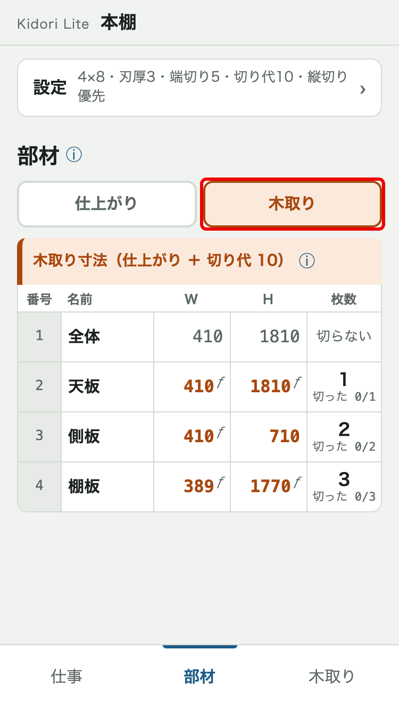
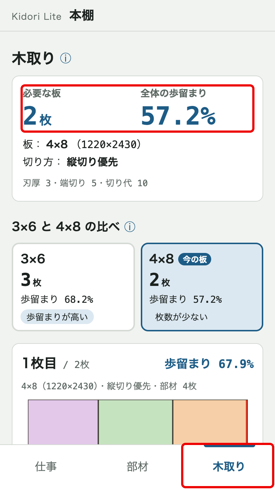
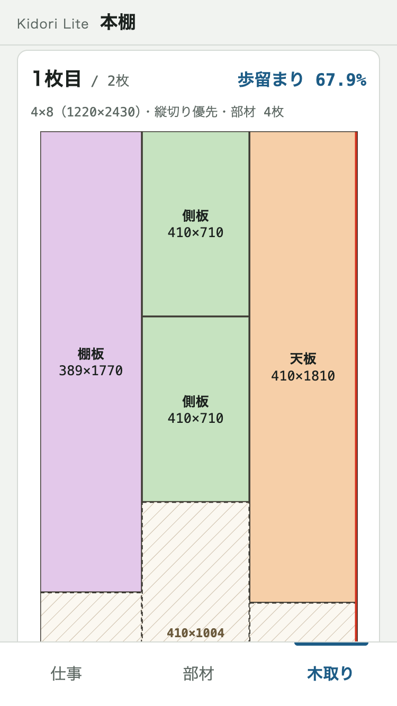
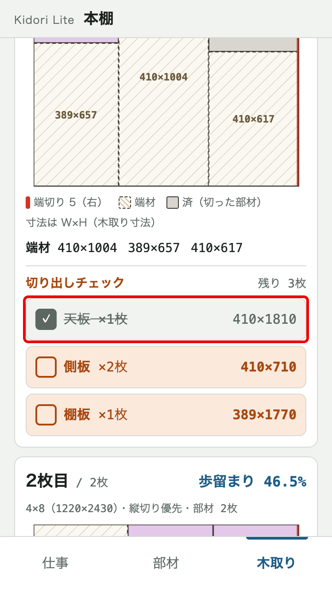

# kidori-lite 取扱説明書

最終更新：2026-10-22（第1.1版）

## 1. このアプリでできること

部材の名前・寸法（W・H）・枚数を表に入れると、パネルソーで切るときの板への並べ方・必要な板の枚数・歩留まりがすぐに出ます。
材料の登録はいりません。寸法は仕上がり寸法で入れれば、切り代を足した木取り寸法はアプリが出します。

## 2. 最低限の操作手順

設定は最初のまま（4×8・刃厚3・端切り5・切り代10・縦切り優先）で使えます。
ここでは、次の棚（仕事の名前「本棚」）を例にします。

| 部材 | W | H | 枚数 |
|---|---|---|---|
| 全体 | 400 | 1800 | 0（寸法だけ） |
| 天板 | 全体.W | 全体.H | 1 |
| 側板 | 全体.W | 700 | 2 |
| 棚板 | 天板.W − 20 − メラミン1 | 天板.H − 20 × 2 | 3 |

### 手順1 仕事を作る

入力をまとめて保存するために、まず仕事を作ります。

1. 下のタブ「仕事」で「＋ 新しい仕事を作る」を押す
2. 「新しい仕事の名前」の欄に「本棚」と入れる
3. 「作って開く」を押す（部材の画面が開き、部材の表が出ます）

赤い枠：「新しい仕事の名前」の欄、「作って開く」

### 手順2 1行目に名前と W を入れる

表の1行目に「全体」を入れます。名前はスマホのキーボード、W・H・枚数は画面の下に出るアプリのキーで入れます。

1. 表の1行目の「名前」の欄を押す（スマホのキーボードが出ます）
2. 「全体」と入れる
3. キーボードの「次へ」（改行）を押す（W の欄に移り、アプリのキーが出ます）
4. 「4」「0」「0」を押す（キーの上の行に「全体 W 400 ＝ 400」と出ます）
5. 「次へ」を押す（H の欄に移ります）

赤い枠：W の欄、キーの上の行、「次へ」

### 手順3 H と枚数を入れる

1. 「1」「8」「0」「0」を押す
2. 「次へ」を押す（枚数の欄に移ります）
3. 「0」を押す（全体は切らずに寸法だけを持つ行なので 0 です）
4. 「次へ」を押す（次の行の名前の欄に移り、スマホのキーボードが出ます）

赤い枠：入れ終わった1行目

### 手順4 式で寸法を入れる

天板・側板・棚板は、ほかの部材の寸法を使った式で入れます。全体の寸法を変えれば、ほかの部材もいっしょに変わります。ここでは棚板の W で説明します。天板・側板も同じやり方で、表の上から順に入れてください。

1. 4行目の名前に「棚板」と入れ、キーボードの「次へ」を押す（W の欄に移ります）
2. 「部材」のタブで「天板」を押す
3. 「天板.W」を押す
4. 「−」「2」「0」「−」を押す
5. 「調整寸法」のタブを押す
6. 「メラミン1」を押す（キーの上の行に「＝ 379」と出ます）
7. 「次へ」を押し、H も同じやり方で「天板.H − 20 × 2」と入れる（「＝ 1760」と出ます）
8. 「次へ」を押し、枚数に「3」を入れる

赤い枠：「部材」のタブ、「天板.W」

赤い枠：キーの上の行（式と ＝ 379）、「調整寸法」のタブ、「メラミン1」

### 手順5 木取り寸法を見る

パネルソーで切る寸法（仕上がり寸法 ＋ 切り代 10）を確かめます。

1. 表の上のタブ「木取り」を押す（棚板は W 389・H 1770 になります）

赤い枠：［木取り］のタブ

### 手順6 木取りの結果を見る

何枚の板が要るか、どう並べて切るかを見ます。

1. 画面の下のタブ「木取り」を押す
2. 上の「必要な板」と「全体の歩留まり」を見る（例：2枚、57.2%）
3. 下へ送って、板1枚ごとの配置図を見る（部材の名前と木取り寸法が書いてあります）

赤い枠：必要な板・全体の歩留まりのまとめ、下のタブ「木取り」

### 手順7 切った部材にチェックを付ける

どこまで切ったかを分かるようにします。

1. 天板を切ったら、その板の配置図の下「切り出しチェック」で「天板 ×1枚」を押す（配置図の天板がグレーになります）

赤い枠：「天板 ×1枚」の行

## 3. 困ったら

- 見出しの横の「ⓘ」を押すと、その項目の説明が出ます。
- 入力は自動で保存されます。保存先はこのスマホの中なので、ほかのスマホからは見られません（ほかの人に渡すときは「この仕事を送る」。4章）。

## 4. 画面ごとの言葉と機能

### 画面の全体

- **下のタブ（仕事・部材・木取り）**：画面を切り替えます。仕事を開いていないときは「仕事」しか押せません。
- **一番上の名前**：いま開いている仕事の名前です。

### 仕事の画面

- **「＋ 新しい仕事を作る」**：名前を入れて「作って開く」で仕事を作ります。名前は初め「仕事 10/22」のように日付が入っています。新しい仕事は、いつも最初の設定から始まります。
- **保存した仕事**：保存した仕事の一覧です。名前・部材の数・最後に変えた日を出し、新しい順に並びます。開いている仕事には「開いている」と出ます。
- **「開く」／「続きを開く」**：その仕事を開き、部材の画面に移ります。
- **「名前を変える」**：仕事の名前を変えます。
- **「コピー」**：仕事を写して「本棚のコピー」のような仕事を作ります。設定と部材はそのまま写します（チェックは写しません）。
- **「削除」**：確かめてから仕事を消します。元に戻せません。

### 仕事の画面（共有とバックアップ）

- **「この仕事を送る」**：その仕事（設定・部材と、式で使っている調整寸法）を1つのファイル（例：本棚.kidori-lite.json）にし、LINE・メール・AirDrop・「ファイル」に保存 などで送ります。切り出しチェックと仕上がりの完了は外して送ります。
- **「バックアップを書き出す」**：全部の仕事と調整寸法を1つのファイル（例：kidori-lite-バックアップ-2026-10-22.json）にします。「ファイル」に保存しておくと、スマホを替えたときなどに戻せます。
- **「ファイルから取り込む」**：受け取ったファイルやバックアップのファイルを選びます。受け取ったファイルは、先に「ファイル」に保存しておきます。
- **取り込みの確認**：送られた仕事のファイルなら「共有された仕事：本棚（部材 4件）」、バックアップなら「バックアップ：仕事 ◯件」と仕事の名前が出ます。「取り込む」（バックアップは「追加する」）で、コピーとして新しい仕事に足します。今ある仕事は変わりません。「やめる」で何もしません。
- **取り込んだあと**：送った人と受け取った人で別々に編集します。片方を直しても、もう片方は変わりません。調整寸法は、同じもの（例：メラミン1）があればそれを使い、無ければ自分の一覧に足します。
- **読み込めませんでした**：壊れたファイルや、kidori-lite のものでないファイル（kidori のファイルも）を選んだときに出ます。今のデータは変わりません。
- **ファイルの中身**：送ったファイルやバックアップのファイルは、持っている人なら誰でも中身を見られます。見られて困る仕事は送らないでください。

### 部材の画面（上の「設定」）

- **設定**：画面の上にたたんであり、押すと開きます。たたんだままでも「4×8・刃厚3・端切り5・切り代10・縦切り優先」のように今の設定が出ます。調整寸法のほかは仕事ごとに保存します。
- **板のサイズ**：3×6（910×1820）・4×8（1220×2430）・自由入力から選びます。自由入力は妻手（短い辺）と長手（長い辺）を入れます。
- **刃厚**：1回切るごとに刃で削れて消える幅です。初めは 3。0 でもかまいません。
- **端切り**：板の端を最初に切り落として矩を出す幅です（刃厚を含む）。初めは 5。0 で端切りなし。
- **切り代**：あとで削り仕上げるための余分です。初めは 10。W・H に同じだけ足して木取り寸法にします。
- **切り方**：縦切り優先（板を縦長に置き、長手方向の帯から切り分ける）・横切り優先（板を横長に置き、妻手方向の帯から切り分ける）・おまかせ（両方を計算し、必要な板が少ないほう）。
- **調整寸法**：逃げ・ほぞ・メラミンなど、式の中で足したり引いたりする寸法です。初めはメラミン1・シート0.5 が入っています。どの仕事でも同じ一覧を使います。
- **調整寸法を追加**：名前を［逃げ］［ほぞ］［自由入力］から選び、寸法を入れて「追加」を押します。
- **「編集」「削除」「選んで削除」**：調整寸法を変える・消すときに使います。使っている仕事があるときは「◯件の仕事で使っています」と出て、確かめてから変えます。寸法を変えると、使っている全部の仕事の値が変わります。

### 部材の画面（部材の表）

- **［仕上がり］のタブ**：家具として完成したときの寸法（仕上がり寸法）の表です。部材の入力はこのタブの表だけでします。
- **［木取り］のタブ**：パネルソーで切る寸法（木取り寸法 ＝ 仕上がり寸法 ＋ 切り代）の表です。見るだけで、押しても編集にはなりません。
- **番号・名前・W・H・枚数**：表の列です。表の下にはいつも空の行があり、いちばん下の行に入れると空の行が1つ増えます。何も入っていない行は保存しません。
- **名前**：押すとスマホのキーボードで入れます。同じ仕事の中で同じ名前は使えません。空のままでもよく、そのときは木取りの画面などで「#3」のように番号で出ます。名前の無い部材は、式で使えません。名前を変えると、その名前を使っている式も書き換わります。
- **W・H**：部材の板の面の2つの寸法です。欄を押すと枠が付き、画面の下にアプリのキーが出ます（スマホのキーボードは出ません）。
- **枚数**：その部材を何枚切り出すかです。数字だけのキーが出ます。0 は寸法だけの行（例：全体）で、切り出さず式で使う寸法だけを持ちます。
- **枚数が空の行**：薄く出て、木取りの計算に入りません。W・H を入れても、枚数を入れるまでは木取りに出ません。
- **「次へ」**：名前 → W → H → 枚数 → 次の行の名前 の順に移ります。名前の欄ではキーボードの「次へ」（改行）で W に移ります。
- **「閉じる」**：アプリのキーをしまいます。
- **ƒ**：式で入れた欄の印です。欄には計算した寸法が出ます。式の全文は、欄を押すとキーの上の行に出ます。
- **エラー**：式が計算できないときは赤で「エラー」と出ます。押すとキーの上の行に理由が出ます。その部材は木取りの計算から外れます。
- **↺**：番号の横に出る、「回転してよい」の部材の印です。
- **グレーの行**：仕上がりの完了を付けた部材です。
- **「全部回転してよい」**：オンにすると全部の部材が「回転してよい」に、オフにすると全部「回転しない」になります。部材ごとに違うときは「一部」と出ます。
- **切らない**：［木取り］のタブで、枚数 0 の行に出ます。
- **切った 0/2**：［木取り］のタブに出る、切り出しチェックを付けた数／全部の枚数です。
- **「選んでコピー」**：ほかの仕事で部材を使うときに押します。番号の列がチェックになるので、部材を選んで「コピー」を押します。式は式のまま覚えます。覚えるのは最後にコピーした1回分だけです。
- **「貼り付け（◯件）」**：コピーした部材があるときに出ます。押すと「◯件を追加します（足せないもの ◯件）」と中身が出て、「追加する」で今の部材の後ろに足します。今の部材と同じ名前のものは足しません。貼った式が、この仕事に無い部材を使っているときは「式に無い部材があります」と出ます。
- **「選んで削除」**：番号の列がチェックになるので、消す部材を選んで「削除」を押します。「◯件の部材を削除しますか？」と確かめてから、まとめて消します。
- 「選んでコピー」「貼り付け」「選んで削除」は［仕上がり］のタブのときに出ます。

### 部材の画面（番号を押すと出るメニュー）

- **回転**：「回転しない」（W を板の妻手、H を板の長手に合わせて置く）・「回転してよい ↺」（W・H を入れ替えて置いてもよい）。初めは「回転しない」です。
- **仕上がりの完了**：「まだ」・「仕上がった」。仕上げ終わった部材を「仕上がった」にすると、行がグレーになります。木取りの計算には影響しません。
- **「複製（すぐ下に足す）」**：同じ仕事の中で部材を増やすときに使います。すぐ下に「棚板のコピー」の名前で足すので、名前などを直します。
- **「上に行を入れる」**：その行の上に空の行を入れ、名前の欄に移ります。
- **「削除」**：部材を消します。式でこの部材を使っている部材があるときは、それを示して「削除する」で確かめます。そうでなければ、すぐに消えます。
- **「閉じる」**：メニューを閉じます。回転と仕上がりの完了は、押したときにもう保存されています。

### 部材の画面（W・H のキー）

- **キーの上の行**：選んでいる欄の部材と W・H、式の全文、計算した仕上がり寸法（例：「＝ 379」）が出ます。式がまちがっているときは、同じ所に赤で理由が出ます。
- **式**：数値の代わりに、ほかの部材の寸法や調整寸法を使った計算を入れられます（例：天板.W − 20 − メラミン1）。式の中の部材の寸法は、いつも仕上がり寸法を使います。
- **「部材」「調整寸法」のタブ**：「部材」は部材名を押してから「天板.W」「天板.H」を押すと入ります（「◀ 戻る」で部材名の一覧に戻ります）。「調整寸法」は「メラミン1」などを押すと入ります。
- **数字・記号のキー**：数字と ( ) × ÷ + − . です。「◀」「▶」で入れる位置を動かし、「1字消す」「全部消す」で消します。天板.W やメラミン1 は1つの塊として動かし・消します。
- **式のエラー**：無い部材・削除した調整寸法を使っている、部材どうしがお互いを使っている、計算の結果が 0 以下、のときです。

### 木取りの画面

- **必要な板**：部材を全部切り出すのに要る板の枚数です。
- **全体の歩留まり**：板の面積のうち、部材（木取り寸法）に使えた割合です。
- **板・切り方**：今の板のサイズと切り方です。おまかせのときは、選ばれた切り方に「おまかせで選択」と出ます。設定は部材の画面の「設定」で変えます。
- **3×6 と 4×8 の比べ**：同じ部材を 3×6 と 4×8 で計算した枚数と歩留まりです。「今の板」「枚数が少ない」「歩留まりが高い」の印が付きます。押すと、その板のサイズに切り替わり、仕事に保存します。
- **板に収まらない部材**：どう置いても板に入らない部材です。寸法か板のサイズを見直します。
- **計算から外した部材（寸法のエラー）**：式がエラーの部材です。部材の画面で式を直すと木取りに入ります。
- **配置図**：板1枚ごとの並べ方の図です（「1枚目 / 2枚」）。部材の名前と木取り寸法（W×H）が書いてあります。名前の無い部材は「#3」のように番号で出ます。部材は右（端切りをした側）の上から詰め、端材は左下に残ります。端切りは赤い線、端材は斜線で出ます。
- **歩留まり（1枚ごと）**：その1枚の歩留まりです。配置図の上の右に出ます。
- **端材**：切り出したあとに残る板のうち、W・H とも 30mm 以上のものです。大きい順に一覧で出し、配置図の中にも寸法を書きます（刃厚の分を除いた大きさ）。
- **切り出しチェック**：配置図の下の、その1枚の部材の一覧です。同じ部材は1行（例：「側板 ×2枚」）で、押すとその1枚の中の同じ部材が全部チェックされます。チェックした部材は配置図でグレー（済）になります。「残り ◯枚」も出ます。
- **固定**：1つ目のチェックで、その1枚の並べ方が固定されます（「固定」の印が出ます）。そのあと部材や設定を変えても、その1枚は変わらず、残りの部材だけを並べ直します。チェックを全部外すと固定も外れ、今の部材で並べ直します。
- **切り終わり**：その1枚の部材を全部チェックすると、「切り終わり ◯枚」として下にたたみます。押すと開いて見られます。
- **部材が変わっています**：固定した1枚の部材の寸法や枚数をあとで変えた（または部材を削除した）ときの知らせです。固定はそのままです。並べ直すときは、その1枚のチェックを全部外します。
- **部材ごとの進み具合**：固定した1枚があるときに出る、部材ごとの切った数（例：側板 2/2）です。
